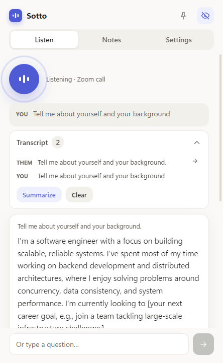
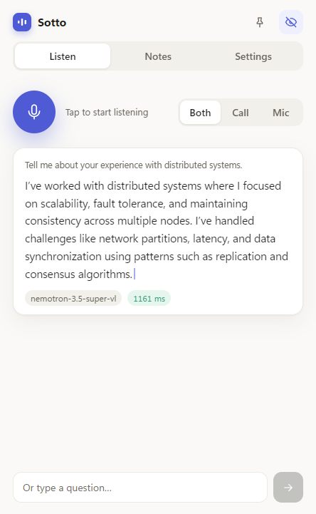
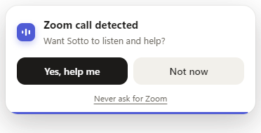

<p align="center">
  
</p>

<h1 align="center">Sotto</h1>
<p align="center"><i>sotto voce — in a quiet voice.</i><br/>A quiet, instant copilot for live conversations.<br/>It listens, notices the question, and whispers an answer drawn from your own CV and notes.</p>

<p align="center">
  
  
  
</p>

## What it does

- **Hears the question.** Listens to the call's sound and your microphone, and turns speech into text *while it is being spoken*.
- **Answers in about a second.** Streams an answer in the first person, grounded in your CV. Several free models race each other and the first one to reply wins.
- **Notices your calls.** When Zoom, Teams, Webex, Meet and similar start using your microphone, a small popup asks whether you want help. It stops by itself when the call ends.
- **Stays out of sight.** One switch hides the window from screen sharing and recordings. <kbd>Ctrl</kbd>+<kbd>Shift</kbd>+<kbd>H</kbd> hides or shows it instantly.
- **Useful in the moment.** A live transcript with an *Answer this* button, quick *Shorter / More detail / Example* re-asks, <kbd>Ctrl</kbd>+<kbd>Shift</kbd>+<kbd>A</kbd> to answer whatever was just asked, and a one-click meeting summary with action items.

It is deliberately small: a single window, three screens (Listen, Notes, Settings), about 2,000 lines of code, three runtime dependencies.

## Get started

**Windows 10/11.** Download `Sotto-Setup-<version>.exe` from [Releases](https://github.com/Partharsid/sotto/releases), run it, then:

1. **Settings → Answers:** paste a free key — [OpenRouter](https://openrouter.ai/keys) (free models, no card) or [Gemini](https://aistudio.google.com/apikey).
2. **Settings → Listening:** press *Set up* once for free, private, on-device speech recognition (needs [Python 3.9+](https://python.org); downloads ~100 MB once). Or choose Deepgram / a Whisper API instead.
3. **Notes:** add your CV (PDF, Word or text).
4. Tap the circle, or just join a call.

> The installer is not code-signed yet, so Windows SmartScreen may say "unrecognized app": choose **More info → Run anyway**. The source is all here, and you can build it yourself (below).

**Known limits (v0.1.0):** Windows only. English only. The on-device engine needs Python installed. Call detection was verified against the structure of the real Windows data and with a stand-in for the detector, but not yet against a live Zoom/Teams call. Please [open an issue](https://github.com/Partharsid/sotto/issues) if a call is not noticed (Settings → Meetings shows what Windows reports).

## How it works

```
 call sound + mic ──► speech engine ──► question? ──► answer (several models race) ──► you
   (Windows loopback)   Moonshine, on-device         CV passages added      first token wins
                        or Deepgram / Whisper API
```

| Part | What it is |
|---|---|
| `src/renderer/` | The UI: React + plain CSS, no component library. |
| `src/server/` | A tiny local API (Express, bound to `127.0.0.1`): answers, document reading, speech engine control. |
| `src/main/` | The Electron shell: one window, the popup, call detection, global hotkeys. |
| `stt-sidecar/` | A small Python process that runs [Moonshine](https://github.com/moonshine-ai/moonshine) (MIT) for on-device streaming speech-to-text. |

**Call detection** reads which program has the microphone open (the same signal as Windows' mic-in-use indicator). Nothing is recorded to do this. *Settings → Meetings* shows live which programs are using your mic, so you can see it working.

## Privacy

- Your CV, transcript and keys stay on your computer. The only things that leave it are the text of a question (plus relevant CV passages) sent to the answer provider **you** chose, and audio sent to Deepgram or a Whisper API **if you choose those**. The default on-device engine sends no audio anywhere.
- API keys you paste are stored locally in the app's storage (not encrypted at rest). Keys in `.env` are read only by the local server.
- The local server accepts connections from this machine only and rejects requests from web pages.

## Responsible use

Sotto can hide itself from screen sharing and recordings. Use it where that is allowed. Many interviews, exams and meetings forbid AI assistance or undisclosed tools, and recording or transcribing other people can need their consent. You are responsible for following the rules of the setting you use it in.

## Develop

```powershell
pnpm install
copy .env.example .env     # optional: keys for development
pnpm dev                   # UI (Vite) + Electron with hot reload
pnpm test                  # unit tests
pnpm dist                  # builds release/Sotto-Setup-<version>.exe
```

Building the installer on Windows needs Developer Mode on (or an admin shell): electron-builder unpacks a tool bundle that contains symlinks.

Debug switch: `SOTTO_FAKE_MEETING_FILE=<path>` treats a call as "on" while that file exists (to try the popup without a real call).

## Contributing

Issues and pull requests are welcome. Keep it small: new features should earn their place in a one-window app. Run `pnpm typecheck && pnpm test` before opening a PR.

## License

[MIT](LICENSE). Speech models: Moonshine (MIT). The answer and speech providers you connect have their own terms.
